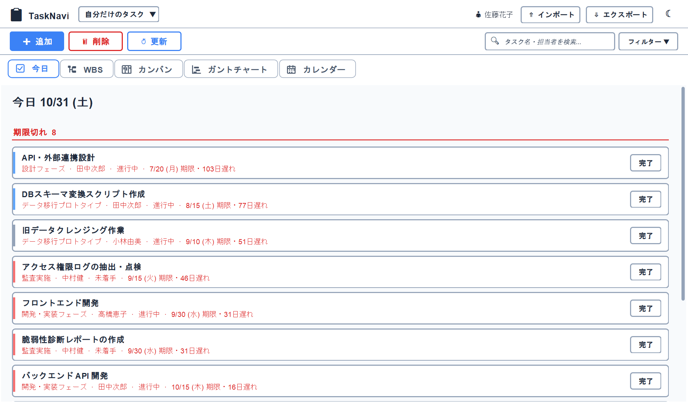
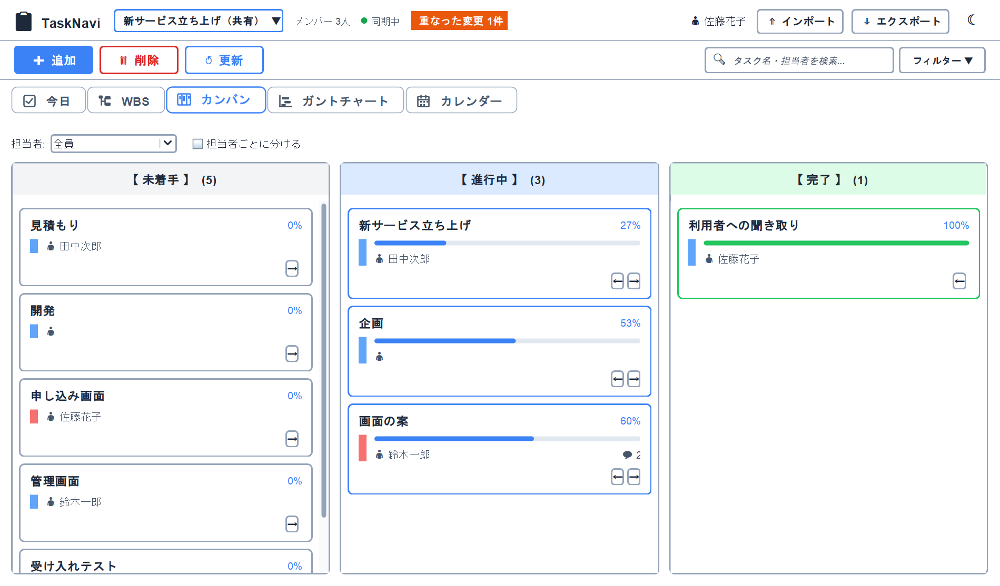
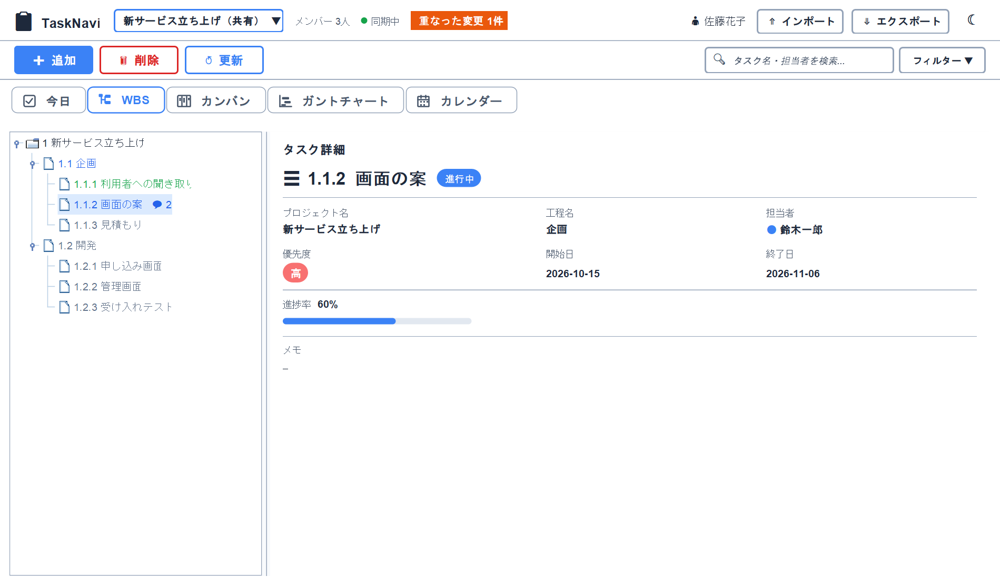
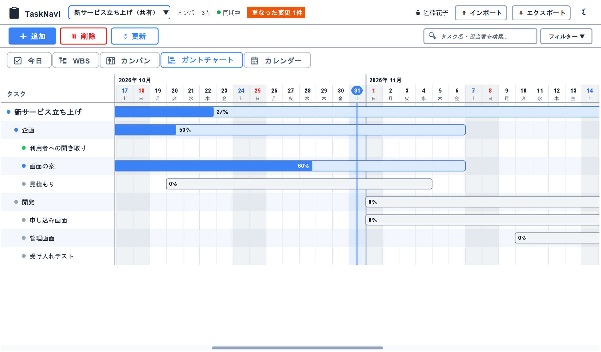
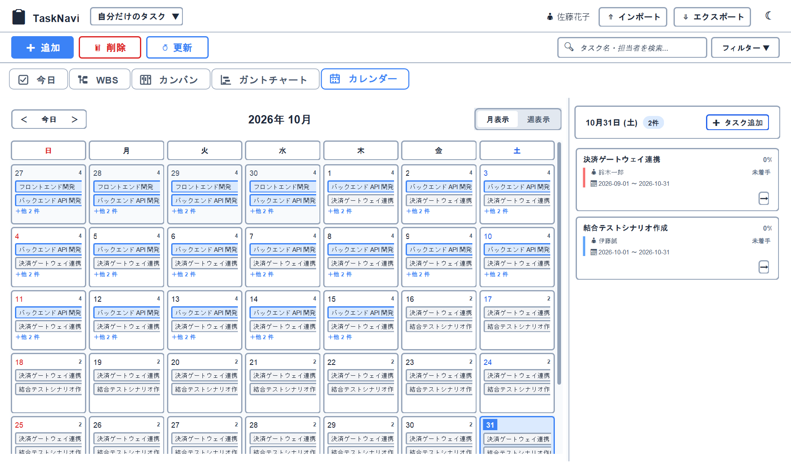
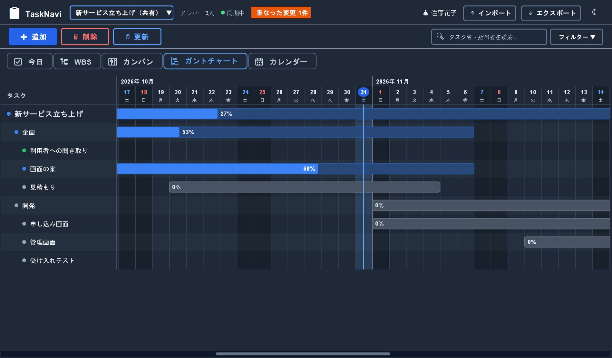
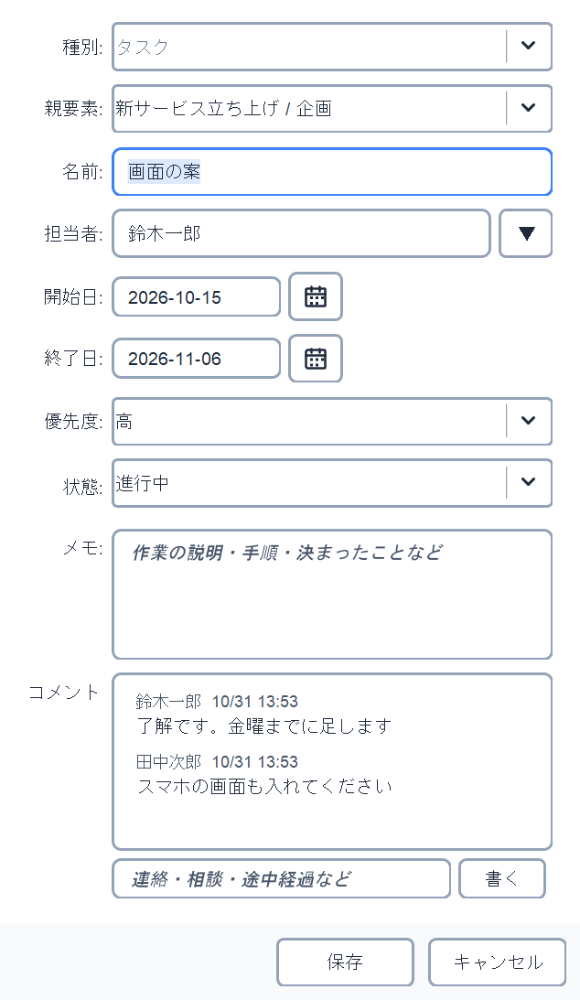
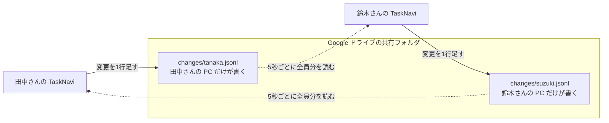

# TaskNavi

**プロジェクト／タスク管理デスクトップアプリ**（Java 25 + Swing）。  
WBS・カンバン・ガント・カレンダーを一つのウィンドウで切り替えます。自分だけのタスクは SQLite に保存し、チームのプロジェクトは Google ドライブの共有フォルダを通して、サーバーなしで数人で共有します。

## 解決したいこと

- 進捗を「一覧・板・日程」で切り替えて見たい
- 担当・期限・優先度を、チームで同じデータとして見たい
- サーバーも常に動かしておく PC も置けない社内で、今ある Google ドライブだけで共有したい
- 使う人の PC に Java を入れずに、zip を展開するだけで使えるようにしたい

## 画面

写真はどれも見本のデータです。WBS・カンバン・ガントは、3人で使っている共有プロジェクトを開いたところです（ヘッダーに「メンバー 3人」と、互いに知らずに同じ項目を変えたときの「重なった変更 1件」が出ています）。

| 「今日」（期限切れ・今日まで・7日以内） | カンバン（担当者・進捗・コメントの件数） |
|---|---|
|  |  |
| **WBS と詳細** | **ガント（開くと今日が真ん中）** |
|  |  |
| **カレンダー** | **ダークテーマ** |
|  |  |



## 主な機能

### タスク管理

- プロジェクト・工程・タスクの3段の階層。担当者・期限・優先度・進捗・状態・メモ（複数行）
- WBS ツリー（右側の名前をダブルクリックで編集）、カンバン（ドラッグか矢印ボタンで状態を変える。担当者で絞り込み、担当者ごとに分けて並べられる）、ガント（開くと今日が真ん中。行は1行おきの色、土日と今日の列にも色が付く）、カレンダー（今日の月を開く。何か月も続くプロジェクトや工程は出さず、日々の作業だけを並べる）。どこで変えても全タブにすぐ反映
- 「今日」タブ（期限切れ・今日まで・7日以内）と、Windows の通知での期限のお知らせ。自分だけのタスクと最近開いた共有プロジェクトをまとめて出す。共有プロジェクトは「自分の担当だけ」（担当者が自分か空のもの）に絞れる（初めはオン）
- 検索（タスク名・担当者・メモ・コメント）と状態の絞り込み、期限超過の強調表示

### チームで共有

- 画面左上の「プロジェクト ▼」で、自分だけのタスクと共有プロジェクトを切り替える。選んだプロジェクトのタスクが全タブに出て、追加・編集・削除・並べ替えができる
- 5秒ごとに他の人の変更を読み直す。ヘッダーにメンバー数・同期の様子・重なった変更の件数が出る
- 他の人が自分を担当にしたり、自分の担当のタスクを変えたりすると、Windows の通知で知らせる
- 同時に同じ項目を変えても消えない。重なった変更は見比べて、消えた方の値に戻せる
- 「変更履歴」で誰がいつ何を何から何に変えたかを見られる。削除したタスクも戻せる
- タスクにコメントを書き足せる（編集画面の下）。同時に書いても重ならず全部残る。自分のコメントは編集・削除でき、元の文は変更履歴に残る。カンバンのカードと WBS の行に件数が出る。自分もコメントしたタスクに他の人がコメントすると通知が出る。コメントを読むには全員が新しい版のアプリにする必要がある
- 担当者はメンバーの一覧から選べる
- 新しい版のアプリで書かれた記録を見つけたら、ヘッダーに「アプリの更新が必要」と出す。アプリの版はウィンドウのタイトルに出る
- 共有プロジェクトのメンバーが自分より新しい版を使っていたら、ヘッダーに「新しい版 ○ があります」と出す。押すと入れ替え方が出る。各自の版はメンバーの一覧で見られる（版は共有フォルダの `members` に書く）

### データの出し入れと安全

- CSV（Excel で編集して取り込み直せる）／JSON のエクスポート・インポート。取り込み前に件数とエラー行を確認でき、「追加」か「置き換え」を選べる。共有プロジェクトへの大量の取り込みは、全部の行をチェックしてから1回で書く
- 削除の「元に戻す」（10秒間）、毎日の DB 自動バックアップ（7日分）
- ログインなしですぐ使える。データは PC の中（`%APPDATA%\TaskNavi`）なので、守りは Windows のログインに任せる。前の版でアカウントごとに分かれていたタスクは、更新時に全部残して1つにまとめる（ログインを消した理由は `docs/beginner-handbook.md` の「ログイン画面を消した理由」）

### 使いやすさ

- ライト／ダークテーマ。起動すると毎回「今日」のタブを開く
- キーボード操作（Ctrl+N 追加、Enter 編集、Delete 削除、Ctrl+F 検索）
- 画面の文言は日本語と英語。英語で起動しても、日本語のデータはゴシック体で出す（Java のままだと中国語の明朝体になる）

## 共有のしくみ（サーバーなし）



1. 変更は、自分の PC 用のファイルの最後に1行足すだけ。1つのファイルを2台で書かないので、Google ドライブが「競合したコピー」を作らない
2. 各 PC は全員のファイルを読み、決まった順（PC の時計ではなく `clock` という番号）に並べて頭から当てはめる。同じファイルからは、どの PC でも同じ一覧になる
3. 記録には「どの値を見て変えたか」も書く。互いに知らずに同じ項目を変えたら、後ろに並んだ方を使い、消えた方の値を「重なった変更」として残す。画面で見比べて戻せる

詳しくは [`docs/beginner-handbook.md`](docs/beginner-handbook.md) の16章。

## なぜこの作りにしたか

- **デスクトップアプリにした**: 社内にサーバーも、常に動かしておく PC も置けない。各自の PC で完結させ、Java ごと入れた exe を zip で配れば、使う人は何も入れなくてよい
- **共有はデータベースではなく、PC ごとの追記ファイルにした**: SQLite のファイルを共有フォルダに置くと、同期の途中のファイルを別の PC が開いて壊れる。1つのファイルを何台も書くと、ドライブが「競合したコピー」を作る。自分のファイルにだけ足していけば、どちらも起きない
- **後から保存した方で黙って上書きしない**: 少人数のチームでいちばん信用を失うのは、知らないうちに他の人の入力が消えること。だから重なりを見つけて残し、戻せるようにした。編集画面を開いている間に届いた変更も、開いた時点の状態と比べて見つける
- **画面は `TaskService` だけを通す**: 保存先（自分の SQLite と共有フォルダ）を `TaskStore` で差し替えるだけで、5つのタブを書き換えずに共有に対応できた
- **ログインをなくした**: データは各自の PC の中にあり、共有する相手はドライブの共有設定で絞れる。パスワードを忘れて自分のタスクを開けなくなる方が困る（理由の全文は handbook の「ログイン画面を消した理由」）
- **やらないと決めたこと**: 管理者と一般でボタンを分けること。編集できる人は記録ファイルを直接書き換えられるので、アプリでボタンを隠しても守りにならない。社外の人を入れるなら、サーバーを置く形に作り直す

## 分かっている限界と、直す予定

社内の少人数（数人〜10人ほど）で使う前提の作りです。それを超えたときに困る所と、直し方の予定です。

- **変更の記録は増え続ける**: 消したり、まとめて小さくしたりはしていない。1回の変更は約 300 バイトなので、5人が1日50回ずつ変えると、年に全体で約 20 MB。5秒ごとに見るのはファイルの大きさと更新時刻だけで、誰かが書いたときだけ全部を読み直す。
  - 予定: 使ってみて読み直しが遅いと分かったら、ある時点の一覧を1つのファイルに書き、それより前の記録は読まない形にする。あわせて、前回読んだ続きだけ読むようにする
- **同時に編集してもロックしない**: 共有ドライブではロックが効くとは限らないので、止めずに両方書き、後ろに並んだ方を使う。消えた方は「重なった変更」に残して戻せる。人数が増えて重なりが多くなったら、サーバーを置く形を考える
- **守りは共有フォルダの権限に任せる**: 編集できる人は記録のファイルを直接書き換えられる。アプリでは、変な端末 ID のファイル名や大きすぎるファイルを読まないだけにしている。社外の人を入れるならサーバーを置く形に作り直す
- **exe に署名していない**: 初回に「発行元不明」の警告が出る。社内の数台に配るだけなら、証明書の費用に見合わないので見送った。入れ方の手順に警告の進め方を書いている
- **自動では更新しない**: 新しい版を使う人がいると、ヘッダーで知らせるだけ。入れ替えは各自が zip を展開し直す
- **英語の表示は画面の文言まで**: 画面・エラー文は英語に切り替わる。入力したデータ、見本のデータ、CSV の見出し（英語の見出しも取り込める）、ログは日本語のまま
- **画面の自動テストは一部だけ**: 共有の画面（`ui/team`）は、ダイアログを出さない部分だけをテストしている（行の約 3 割）。ダイアログは配る前のチェック表で確かめる
- **まだ確かめていないこと**: キーボードだけでの操作、高解像度の画面での見え方

## 技術スタック

| 領域 | 技術 |
|------|------|
| 言語 | Java 25（長く修正が出る LTS の版） |
| UI | Swing + MigLayout |
| DB | SQLite + Flyway |
| ビルド／テスト | Maven, JUnit 6 |
| CI | GitHub Actions（Xvfb 上で `mvn verify`。失敗したテストは注釈で表示）、Qodana、Dependabot（使っている部品の更新と既知の弱点を毎週確認） |
| テストの網羅率 | JaCoCo（割合が決めた値を下回ると CI が止まる） |
| 配布 | jpackage（Java 入りの `TaskNavi.exe`） |

## 設計の要点（面接用）

```
UI（ui/today・wbs・kanban・gantt・calendar ほか）
  → TaskService（追加・編集・削除などの仕事。成功したら TaskEventBus で全画面に知らせる）
    → TaskStore ─┬─ TaskDao        （自分だけのタスク。persistence・SQLite）
                 └─ TeamTaskStore  （共有プロジェクト。team・共有フォルダ）
```

- UI はデータベースや共有フォルダを直接触らない。必ず `TaskService` を通す（`TaskService.createDefault()`）
- 保存先は `TaskStore` で差し替える。共有プロジェクトを選ぶと保存先が `TeamTaskStore` に変わるだけで、タブの側は何も変えずに全タブで共有プロジェクトを扱える
- 画面間の再描画は `TaskEventBus`
- チーム共有（`team` パッケージ）: サーバーなしで共有フォルダを使う。各 PC は自分の変更記録ファイルに追記するだけなので、同期で「競合したコピー」ができない。全員の記録を決まった順に組み立てて一覧にし、互いを知らずに同じ項目を変えた場合は検出して残す
- パッケージは役割ごと（`model` / `service` / `persistence` / `team` / `io` / `util` / `event` / `ui`）。画面は `ui` の中でタブごとに分ける
- 共有フォルダのファイルは信用しない。丸ごと書き直す JSON は一時ファイルに書き切ってから付け替え（落ちても壊れたファイルが残らない）、読むときは大きさに上限を設ける（`TeamFiles`）
- ガントは見えている行と日だけを描き、並べ替えと絞り込みの結果は一覧か条件が変わるまで使い回す。1万件で1回の描き直しは約 15 ミリ秒（直す前は約 150 ミリ秒。測り方は「開発メモ」）

  | タスクの数 | 直す前 | 直した後 |
  |---:|---:|---:|
  | 1,000 | 22 ms | 6 ms |
  | 3,000 | 46 ms | 13 ms |
  | 10,000 | 146 ms | 15 ms |
- 画面の文言とエラー文は `messages*.properties` から取る。日本語と英語でキーがそろっているか、コードで使うキーが全部あるかはテスト（`AppMessagesTest`）で確かめる。テストは日本語に固定して動かし、英語はテストの中で切り替えて確かめる
- テスト 269 件（JUnit 6）。共有の同期の遅れ・オフラインでの同時編集・同じ PC での2重起動も再現して確かめている。本物のメイン画面を両方のテーマで開き、読みにくい文字がないかも確かめている
- テストが通った行の割合（JaCoCo）は次のとおり。共有の記録はチーム全員のデータに響くので、`team` が 90%、全体が 60%、共有の画面（`ui/team`）が 25% を下回ると CI が止まる。パッケージごとの表は CI の実行結果の Summary に出る

  | 範囲 | 行 | 分岐 |
  |---|---:|---:|
  | 全体 | 65% | 54% |
  | 画面以外（`ui` 以外） | 87% | 78% |
  | 共有の記録の読み書き（`team`） | 94% | 82% |
  | 取り込み・書き出し（`io`） | 97% | 85% |

  画面（`ui`）は低め（50〜70%、共有の画面 `ui/team` は 28%）。共有の画面は、ダイアログを出さない部分（開く・閉じる・読み直し・ヘッダーの表示）をテストしている。画面の操作は、メイン画面を開くテストと、配る前のチェック表（[`docs/home-test-checklist.md`](docs/home-test-checklist.md)）で確かめている
- 学習用の読み方: [`docs/beginner-handbook.md`](docs/beginner-handbook.md) / [`docs/study-checklist.md`](docs/study-checklist.md)
- 使う人向けの説明（ダウンロードと使い方）: [`docs/user-guide.md`](docs/user-guide.md)
- 配る前に共有・バックアップ・インポートを試す表: [`docs/home-test-checklist.md`](docs/home-test-checklist.md)
- 本番の始め方（見本の消し方・共有の始め方）と新しい版の配り方: [`docs/rollout-guide.md`](docs/rollout-guide.md)
- 社内で使ってみた結果の記録（始める前と後の数字、不具合と直すまでの日数）: [`docs/results-log.md`](docs/results-log.md)

## 起動方法

JDK 25 が要ります（JAVA_HOME を JDK 25 に向ける）。

```bash
mvn -B verify          # テストと、通った行の割合の確認（表は target/site/jacoco/index.html）
mvn -B -DskipTests package
java -jar target/TaskNavi-1.0-SNAPSHOT-jar-with-dependencies.jar
```

## 配布（Windows）

```bash
mvn -Pdist -DskipTests verify
```

- `target/jpackage/dist/TaskNavi/TaskNavi.exe` … ダブルクリックで起動。Java ごと入っているので、使うパソコンに Java は要りません
- exe には、作ったときの JDK の Java が入ります。修正が長く出る版にそろえるため、JDK 25 以外で作ろうとすると止まります（`pom.xml` の `require-jdk-25`）
- `target/TaskNavi-1.2.0-windows.zip` … 上のフォルダをまとめたもの。展開して `TaskNavi.exe` を起動します。名前の数字はアプリの版（`pom.xml` の `app.version`）なので、配った zip がどの版かが名前で分かります
- 版は `pom.xml` の `app.version`。新しい版を配るときは上げてから作る（チームは全員同じ版にそろえる）
- `TaskNavi.exe --team-profile=test2` … 共有プロジェクトを別の人として使う（1台で2人分の共有を試すとき。手順は教科書16章）
- データ・バックアップ・ログは `%APPDATA%\TaskNavi` に置きます（`tasknavi.db` / `backups` / `logs`）。アプリを入れ替えても消えません
- 署名していないため、初回は Windows が「発行元不明」の警告を出すことがあります（「詳細情報」→「実行」）

## デモ手順（約2分）

1. 起動 → すぐメイン画面（初回はサンプルのプロジェクト入り）
2. 「追加」でタスクを作成
3. カンバン／カレンダーで同じタスクが見えることを確認（EventBus）
4. 検索欄で名前・担当者・メモ・コメントを絞る → フィルタ表示が変わる
5. CSV でエクスポート → Excel で編集・保存 → インポートで件数とエラー行を確認して取り込む
6. （チーム共有）`--team-profile=test2` でもう1つ起動し、同じ共有プロジェクトを開いて、片方の変更が数秒でもう片方に出ることを見る（手順は教科書16章の「1台で2人分を試す手順」）

## このリポジトリで自分が説明できる変更例

- UI／persistence のパッケージ分割と CI 導入
- 担当者キーワード検索、タブ記憶、期限超過表示、絞り込みエクスポート
- Google ドライブの共有フォルダでのチーム共有（変更記録の追記と組み立て、重なった変更の検出と戻し、変更履歴）
- 「今日」タブと期限の通知を全プロジェクトに広げたこと、共有プロジェクトへの大量インポートの高速化
- 使っていないコードの削除と、役割ごとのパッケージへの整理
- 初学者向け handbook / study-checklist

AI エージェントを活用して構築・リファクタを加速しましたが、層分け・テスト・上記の変更内容は自分で追い説明できます。

## 開発メモ

- README の写真の撮り直し（見本のデータだけを一時フォルダに作って撮る。いつものデータと設定には触れない）:

```powershell
mvn -q test-compile dependency:build-classpath "-Dmdep.outputFile=target/cp.txt" "-Dmdep.includeScope=test"
java -cp "target/classes;target/test-classes;$(Get-Content target/cp.txt)" org.tasknavi.tools.ScreenshotTool docs/images
```

- ガントの速さを測る（画面は出さない。上と同じ `target/cp.txt` を使う。件数は変えられる）:

```powershell
java -cp "target/classes;target/test-classes;$(Get-Content target/cp.txt)" org.tasknavi.tools.GanttBenchmark 1000 3000 10000
```

- 試す専用のデータを新しく作る（期限切れ・今日・明日、長い名前、`=1+1`、日付なし、同じ日に重なるタスク、空のプロジェクトなど 42 件。日付は作った日を今日として決める）。同じフォルダに、取り込みを試す `test-data.csv` と、わざと間違えた `test-data-bad.csv`（10 行が理由つきで止まる）もできる。最後の数を付けると、重さを試すタスクをその数だけ足す。いつものデータと、もうデータがあるフォルダには書かない:

```powershell
java -cp "target/classes;target/test-classes;$(Get-Content target/cp.txt)" org.tasknavi.tools.TestDataTool C:\TaskNaviTest
$env:TASKNAVI_DATA_DIR = "C:\TaskNaviTest"; & "C:\TaskNavi\TaskNavi\TaskNavi.exe"
```

  Maven だけで同じことをするなら（IntelliJ の Maven の実行構成にもそのまま書ける）。データのフォルダを指定しないと、いつものデータ（`%APPDATA%\TaskNavi`）が開く:

```powershell
mvn "-Dexec.mainClass=org.tasknavi.tools.TestDataTool" "-Dexec.classpathScope=test" "-Dexec.args=C:\TaskNaviTest" test-compile exec:java
mvn "-Dtasknavi.dataDir=C:\TaskNaviTest" compile exec:java
```

- パッケージ／Maven `groupId` はともに `org.tasknavi`

## ライセンス

個人ポートフォリオ用途。再利用時は作者に確認してください。
